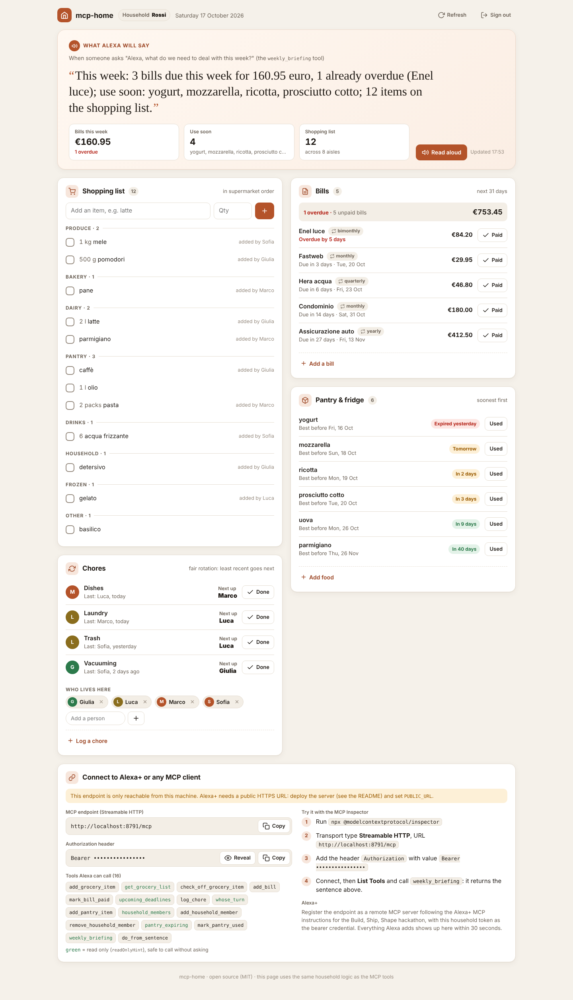
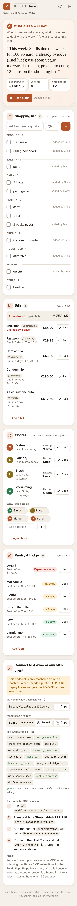
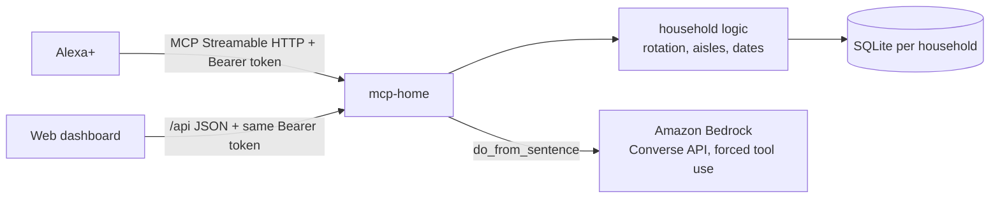

# mcp-home

**A self-hosted MCP server that lets Alexa+ run a household's shared logistics: the shopping list, bills, chores and the food about to expire.**

"Alexa, add oat milk to the shopping list." "Alexa, whose turn is it to take out the trash?" "Alexa, what do we need to deal with this week?"

Families already talk to Alexa in the kitchen. What they lack is one shared memory for the boring stuff: who paid the gas bill, who did the dishes last, what is going off in the fridge. mcp-home is that memory, exposed as an [MCP](https://modelcontextprotocol.io) server over Streamable HTTP so Alexa+ (or any MCP client) can read and update it. A web dashboard on the same server shows the family what Alexa sees, on the kitchen tablet or a phone.



## Tools

| Tool | What it does |
|---|---|
| `add_grocery_item` | Adds to the shared list, grouped by supermarket aisle, ignores duplicates |
| `get_grocery_list` | The list in the order you walk the store (read only) |
| `check_off_grocery_item` | Marks an item as bought |
| `add_bill` | Records a bill; due date as `YYYY-MM-DD` or "tomorrow", "in 10 days", "tra 3 giorni"; optional `repeat` (weekly, monthly, bimonthly, quarterly, yearly) |
| `mark_bill_paid` | Pays the oldest open bill from that provider; a recurring bill gets its next one scheduled |
| `upcoming_deadlines` | Unpaid bills in the next N days, overdue ones flagged, with the total (read only) |
| `log_chore` | "Anna took out the trash" (today by default, or `when`: "yesterday", "2 days ago") |
| `whose_turn` | Fair rotation: whoever did that chore least recently, or never (read only) |
| `household_members` / `add_household_member` / `remove_household_member` | Who is in the chore rotation (listing is read only) |
| `add_pantry_item` / `mark_pantry_used` | Tracks food with expiry dates |
| `pantry_expiring` | What to eat before it goes off (read only) |
| `weekly_briefing` | One sentence Alexa can read aloud: bills due, food to use, list size (read only) |
| `do_from_sentence` | "We're out of milk and the gas bill of 80 euro is due Friday" → runs both actions, using **Amazon Bedrock** |

Resource: `home://briefing` (same content as `weekly_briefing`).

Read-only tools carry the MCP `readOnlyHint` annotation so the assistant can call them without asking for confirmation.

## Dashboard

Open `http://localhost:8000/` (or your deployed URL) and enter a household token once. The page keeps it in that browser's local storage, sends it only as an `Authorization: Bearer` header, and never puts it in a URL.

- **What Alexa will say**: the exact `weekly_briefing` sentence, large, with a *Read aloud* button (browser speech).
- **Shopping list** grouped by aisle in walking order, with check-off and add.
- **Bills** for the next 31 days: overdue ones in red, recurring ones tagged, *Paid* and add.
- **Chores**: whose turn it is for each chore, one-tap *Done*, a log form, and the members of the rotation.
- **Pantry and fridge** with expiry badges (expired, today, tomorrow, within 3 days, later) and *Used*.
- **Connect**: the MCP endpoint URL (`PUBLIC_URL`, or the address the page was opened from), the `Authorization` header with the token hidden until you click *Reveal*, the list of tools with read-only ones marked, and MCP Inspector steps.

It refreshes every 30 seconds, so what someone tells Alexa shows up on the tablet. Light and dark mode follow the system setting; the layout works down to phone width.



The page is one self-contained file (`mcp_home/static/index.html`, no CDNs, strict Content-Security-Policy). It talks to a small JSON API on the same server, protected by the same household tokens as `/mcp`. Every handler calls the same functions in `mcp_home/logic.py` as the MCP tools, so the dashboard and Alexa can never disagree.

| Method and path | Does |
|---|---|
| `GET /api/state` | Everything on the page: briefing, list, bills, chores, members, pantry, connect info |
| `POST /api/groceries` · `POST /api/groceries/check` | Add an item · check one off (`{"item": ...}`) |
| `POST /api/bills` · `POST /api/bills/{id}/pay` | Add a bill (`provider`, `amount`, `due`, `repeat`) · pay one |
| `POST /api/chores` | Log a chore (`chore`, `person`, optional `when`) |
| `POST /api/members` · `DELETE /api/members/{person}` | Add or remove a member of the rotation |
| `POST /api/pantry` · `POST /api/pantry/{id}/use` | Track food (`item`, `expires`) · mark it used |

Each write returns `{"result": ..., "state": ...}` so the page re-renders in one round trip. Requests without a valid token get `401`; ids from another household answer `not_found`.

## How it works



- **Transport**: MCP Streamable HTTP at `/mcp`, stateless JSON responses, built on the official Python SDK (`mcp` 2.x). Tested to negotiate protocol version 2025-11-25, the minimum the Alexa+ track asks for.
- **Households**: every bearer token maps to one household (`HOUSEHOLD_TOKENS="token:household,..."`). Every query filters by household; tokens are compared in constant time. A request without a valid token gets `401`, on `/mcp` and on `/api/*` alike.
- **Host check**: the SDK's DNS-rebinding protection accepts localhost plus the host in `PUBLIC_URL` (and any extra `ALLOWED_HOSTS`), so a deployed `/mcp` answers instead of returning `421`.
- **Bedrock**: `do_from_sentence` calls the Bedrock Converse API with a single forced tool (`plan_actions`) whose JSON schema only allows the four write actions, and passes today's date so "Friday" resolves to a real date. The actions are then validated and executed by the same code the individual tools use, so the model can never write anything the tools could not.

## Run locally

```bash
pip install -r requirements.txt
export HOUSEHOLD_TOKENS="$(openssl rand -hex 24):rossi"
python -m mcp_home.server            # dashboard at http://localhost:8000/, MCP at /mcp
```

Try it with the MCP Inspector (`npx @modelcontextprotocol/inspector`), transport "Streamable HTTP", URL `http://localhost:8000/mcp`, header `Authorization: Bearer <your token>`.

## Deploy on AWS

`infra/deploy-apprunner.sh` builds the Docker image, pushes it to ECR and creates an App Runner service, then prints the MCP endpoint. You need:

- an ECR access role for App Runner (`APPRUNNER_ECR_ROLE_ARN`),
- for `do_from_sentence`: `BEDROCK_MODEL_ID` (any Bedrock model that supports tool use) and an App Runner instance role allowed to call `bedrock:InvokeModel`,
- `PUBLIC_URL` set to the service URL, so the OAuth protected-resource metadata points at the right place.

Data lives in SQLite inside the container: fine for a demo, it resets on redeploy. Mount a volume or swap `mcp_home/db.py` for DynamoDB for real use.

## Connect to Alexa+

Register the deployed `https://<host>/mcp` endpoint as a remote MCP server following the Alexa+ MCP instructions provided for the Build, Ship, Shape hackathon, using a household token as the bearer credential.

## Tests

```bash
pip install -r requirements-dev.txt
pytest
```

The suite covers aisle grouping, walking order and duplicates, household isolation, spoken dates, bills, overdue detection and recurring bills, fair chore rotation and members, pantry expiry and the spoken briefing, the Bedrock request shape (with a fake client), the database migration, and end-to-end runs over HTTP: on both `/mcp` and the dashboard API, unauthenticated requests get `401` and two households see only their own data.

## License

MIT
