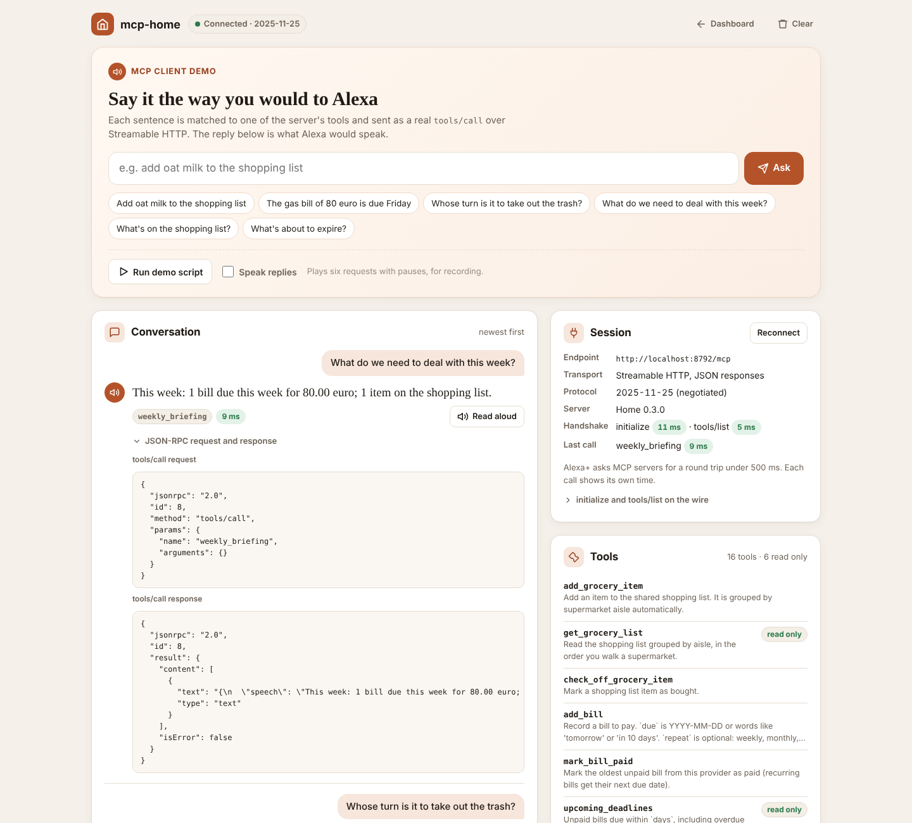
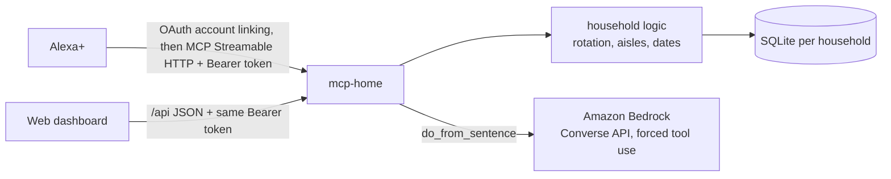

# mcp-home

**A self-hosted MCP server that lets Alexa+ run a household's shared logistics: the shopping list, bills, chores and the food about to expire.**

"Alexa, add oat milk to the shopping list." "Alexa, whose turn is it to take out the trash?" "Alexa, what do we need to deal with this week?"

Families already talk to Alexa in the kitchen. What they lack is one shared memory for the boring stuff: who paid the gas bill, who did the dishes last, what is going off in the fridge. mcp-home is that memory, exposed as an [MCP](https://modelcontextprotocol.io) server over Streamable HTTP so Alexa+ (or any MCP client) can read and update it. A web dashboard on the same server shows the family what Alexa sees, on the kitchen tablet or a phone.


## Tools

| Tool | What it does |
|---|---|
| `add_grocery_item` | Adds to the shared list, grouped by supermarket aisle, ignores duplicates |
| `get_grocery_list` | The list in the order you walk the store (read only) |
| `check_off_grocery_item` | Marks an item as bought |
| `add_bill` | Records a bill; due date as `YYYY-MM-DD` or "tomorrow", "in 10 days", "tra 3 giorni"; optional `repeat` (weekly, monthly, bimonthly, quarterly, yearly) |
| `mark_bill_paid` | Pays the oldest open bill from that provider; a recurring bill gets its next one scheduled |
| `upcoming_deadlines` | Unpaid bills in the next N days, overdue ones flagged, with the total (read only) |
| `log_chore` | "Anna took out the trash" (today by default, or `when`: "yesterday", "2 days ago") |
| `whose_turn` | Fair rotation: whoever did that chore least recently, or never (read only) |
| `household_members` / `add_household_member` / `remove_household_member` | Who is in the chore rotation (listing is read only) |
| `add_pantry_item` / `mark_pantry_used` | Tracks food with expiry dates |
| `pantry_expiring` | What to eat before it goes off (read only) |
| `weekly_briefing` | One sentence Alexa can read aloud: bills due, food to use, list size (read only) |
| `do_from_sentence` | "We're out of milk and the gas bill of 80 euro is due Friday" → runs both actions, using **Amazon Bedrock** |

Resource: `home://briefing` (same content as `weekly_briefing`).

Read-only tools carry the MCP `readOnlyHint` annotation so the assistant can call them without asking for confirmation.

## Dashboard

Open `http://localhost:8000/` (or your deployed URL) and enter a household token once. The page keeps it in that browser's local storage, sends it only as an `Authorization: Bearer` header, and never puts it in a URL.

- **What Alexa will say**: the exact `weekly_briefing` sentence, large, with a *Read aloud* button (browser speech).
- **Shopping list** grouped by aisle in walking order, with check-off and add.
- **Bills** for the next 31 days: overdue ones in red, recurring ones tagged, *Paid* and add.
- **Chores**: whose turn it is for each chore, one-tap *Done*, a log form, and the members of the rotation.
- **Pantry and fridge** with expiry badges (expired, today, tomorrow, within 3 days, later) and *Used*.
- **Connect**: the MCP endpoint URL (`PUBLIC_URL`, or the address the page was opened from), the `Authorization` header with the token hidden until you click *Reveal*, the list of tools with read-only ones marked, and MCP Inspector steps.

It refreshes every 30 seconds, so what someone tells Alexa shows up on the tablet. Light and dark mode follow the system setting; the layout works down to phone width.


The page is one self-contained file (`mcp_home/static/index.html`, no CDNs, strict Content-Security-Policy). It talks to a small JSON API on the same server, protected by the same household tokens as `/mcp`. Every handler calls the same functions in `mcp_home/logic.py` as the MCP tools, so the dashboard and Alexa can never disagree.

| Method and path | Does |
|---|---|
| `GET /api/state` | Everything on the page: briefing, list, bills, chores, members, pantry, connect info |
| `POST /api/groceries` · `POST /api/groceries/check` | Add an item · check one off (`{"item": ...}`) |
| `POST /api/bills` · `POST /api/bills/{id}/pay` | Add a bill (`provider`, `amount`, `due`, `repeat`) · pay one |
| `POST /api/chores` | Log a chore (`chore`, `person`, optional `when`) |
| `POST /api/members` · `DELETE /api/members/{person}` | Add or remove a member of the rotation |
| `POST /api/pantry` · `POST /api/pantry/{id}/use` | Track food (`item`, `expires`) · mark it used |

Each write returns `{"result": ..., "state": ...}` so the page re-renders in one round trip. Requests without a valid token get `401`; ids from another household answer `not_found`.

## MCP client demo

Open `http://localhost:8000/demo` (linked from the dashboard header and its Connect panel). The page is a real MCP client running in the browser. It sends `initialize` (protocol 2025-11-25), `notifications/initialized`, `tools/list` and `tools/call` to `/mcp` over Streamable HTTP, with the household bearer token. This is the kind of client the Devpost FAQ accepts for the Alexa+ track demo.



- **Say it like you would to Alexa.** "Add oat milk to the shopping list", "The gas bill of 80 euro is due Friday", "Whose turn is it to take out the trash?", "What do we need to deal with this week?". A small deterministic router in the page maps these phrasings to one tool and its arguments. Anything it does not recognise goes to `do_from_sentence`, which needs Amazon Bedrock; without `BEDROCK_MODEL_ID` the page says so.
- **What you see for each call.**
  - The reply as the sentence Alexa would speak, with *Read aloud* (browser speech).
  - The tool that was called.
  - The round-trip time, green under the 500 ms Alexa+ asks for.
  - The JSON-RPC request and response, collapsed.
- **Session panel.** The negotiated protocol version, the server info, the handshake timings, and the `initialize`/`tools/list` exchange. Next to it, the 16 tools with their read-only badges.
- **Run demo script** plays six requests with pauses, typing each sentence first; tick *Speak replies* to hear them. Good for recording the video. Add `?speak` to the URL to start with speech on.

It uses the same strict Content-Security-Policy as the dashboard (`connect-src 'self'`, no inline event handlers) and the same token storage.

## How it works



- **Transport**: MCP Streamable HTTP at `/mcp`, stateless JSON responses, built on the official Python SDK (`mcp` 2.x). Tested to negotiate protocol version 2025-11-25, the minimum the Alexa+ track asks for.
- **Households**: every bearer token maps to one household, either a static one (`HOUSEHOLD_TOKENS="token:household,..."`) or an OAuth access token issued by the built-in authorization server when someone links an app, such as Alexa+, with that household's token. Every query filters by household; tokens are compared in constant time. A request without a valid token gets `401`, on `/mcp` and on `/api/*` alike.
- **OAuth 2.1**: authorization code + PKCE S256, refresh tokens, `client_credentials`, RFC 9728 and RFC 8414 metadata, all in `mcp_home/oauth.py` (see [Connect to Alexa+](#connect-to-alexa)).
- **Host check**: the SDK's DNS-rebinding protection accepts localhost plus the host in `PUBLIC_URL` (and any extra `ALLOWED_HOSTS`), so a deployed `/mcp` answers instead of returning `421`.
- **Bedrock**: `do_from_sentence` calls the Bedrock Converse API with a single forced tool (`plan_actions`) whose JSON schema only allows the four write actions, and passes today's date so "Friday" resolves to a real date. The actions are then validated and executed by the same code the individual tools use, so the model can never write anything the tools could not.

## Run locally

```bash
pip install -r requirements.txt
export HOUSEHOLD_TOKENS="$(openssl rand -hex 24):rossi"
python -m mcp_home.server            # dashboard at http://localhost:8000/, MCP at /mcp
```

Try it with the MCP Inspector (`npx @modelcontextprotocol/inspector`), transport "Streamable HTTP", URL `http://localhost:8000/mcp`, header `Authorization: Bearer <your token>`.

## Deploy on AWS

`infra/deploy-apprunner.sh` builds the Docker image, pushes it to ECR and creates an App Runner service, then prints the MCP endpoint. You need:

- an ECR access role for App Runner (`APPRUNNER_ECR_ROLE_ARN`),
- for `do_from_sentence`: `BEDROCK_MODEL_ID` (any Bedrock model that supports tool use) and an App Runner instance role allowed to call `bedrock:InvokeModel`,
- `PUBLIC_URL` set to the service URL, so the OAuth metadata, the token audience and the host check all use it. For account linking also pass `OAUTH_CLIENT_ID`, `OAUTH_CLIENT_SECRET`, `OAUTH_REDIRECT_URIS` and `ALEXA_COMPAT=1` (see below).

Data lives in SQLite inside the container: fine for a demo, it resets on redeploy. Mount a volume or swap `mcp_home/db.py` for DynamoDB for real use.

## Connect to Alexa+

**Hackathon reality first.** The Devpost FAQ says Amazon's Alexa+ add-on tools (Category SDK, MCP Toolkit, `alexa-ai` CLI, Web Simulator) "are in preview" for select partners, that participants cannot get access, and that "there's no way for any participant to connect a self-hosted MCP server to a real Alexa+ device". For the demo, any real MCP client speaking Streamable HTTP is accepted (MCP Inspector with a household token, or the dashboard). The server still implements what the [Alexa+ MCP Toolkit](https://developer.amazon.com/docs/alexaplus/add-ons/mcp-toolkit-quickstart.html) asks for, so it can be linked as soon as access opens.

What Amazon requires, and where it lives here:

| Alexa+ MCP Toolkit requirement | mcp-home |
|---|---|
| Streamable HTTP, MCP 2025-11-25 | `/mcp`, tested to negotiate `2025-11-25` |
| Protected Resource Metadata (RFC 9728) at `/.well-known/oauth-protected-resource`; `resource` must equal the manifest URL exactly | served at that path (and at `/.well-known/oauth-protected-resource/mcp`), `resource` = `PUBLIC_URL` + `/mcp`, one authorization server |
| Auth server metadata at `/.well-known/oauth-authorization-server`, `code_challenge_methods_supported` includes `S256` | built in, same origin |
| Authorization code grant with PKCE S256, `resource` parameter | `/authorize` (consent page) and `/token`; S256 is mandatory, `plain` is refused, a wrong `resource` gets `invalid_target` |
| Static client registration, DCR not supported | `OAUTH_CLIENT_ID`, `OAUTH_CLIENT_SECRET`, `OAUTH_REDIRECT_URIS` |
| A refresh token with every access token | yes; rotated on each use, 90 days |
| Service-level `client_credentials` (HTTP Basic, scope `mcp:service`, at most 3600 s, no refresh token) for private servers | yes: that token can `initialize` and `tools/list`, every tool answers "link your household account first" |
| 401 for unauthenticated requests, without a `WWW-Authenticate` header | `ALEXA_COMPAT=1` drops the header on `/mcp` (it stays on by default because MCP Inspector uses it) |
| Bearer token in the `Authorization` header, never in the query string | the only place tokens are read |

Steps, once you have Alexa+ add-on access:

1. Deploy behind HTTPS (`infra/deploy-apprunner.sh`, or a tunnel such as `cloudflared` for testing) and set `PUBLIC_URL=https://<host>`. Check `https://<host>/.well-known/oauth-protected-resource` shows `"resource": "https://<host>/mcp"`.
2. Create the OAuth client the add-on will use: `OAUTH_CLIENT_ID=alexa-home`, `OAUTH_CLIENT_SECRET=$(openssl rand -hex 32)`, and `OAUTH_REDIRECT_URIS` = every redirect URL the Alexa+ Developer Hub lists for your add-on, comma separated (they look like `https://alexa.amazon.com/api/skill/link/<id>`). Set `ALEXA_COMPAT=1`. Restart.
3. Authenticate the CLI and scaffold the add-on: `alexa-ai configure`, then `alexa-ai new mcp --name "Home" --locale en-US --mcp-server-url "https://<host>/mcp"`, and answer yes when it asks whether the add-on needs account linking.
4. Give it the client: `alexa-ai configure-account-linking --addon-id <id> --stage development --client-id alexa-home`, and type the secret at the masked prompt (or export `ALEXA_CLIENT_SECRET`). Alexa reads the endpoints, scopes (`household`) and PKCE support from the metadata above.
5. Fill in `addon-package/addon.json` (descriptions, 3 to 4 example phrases, privacy and terms URLs, icons) and run `alexa-ai deploy`. Run it again whenever the tools change: Alexa+ only refreshes tool information on deployment.
6. In the Alexa app, enable the add-on and link the account. The mcp-home consent page shows where the code will be sent, and asks for the **household token**. Entering it proves you belong to that household. From then on Alexa sends an access token that maps to that household only.

To unlink a household from every app at once, remove or change its entry in `HOUSEHOLD_TOKENS`: its OAuth tokens stop working on the next request. Apps can also revoke a grant at `/revoke` (RFC 7009).

### OAuth for other MCP clients

The same authorization server works for any MCP client that follows the 2025-11-25 authorization spec. Clients that register themselves (RFC 7591) need `OAUTH_DYNAMIC_REGISTRATION=1`. It is off by default because Alexa does not use it, and an open registration endpoint lets anyone create a client. Registered redirect URIs must be HTTPS or loopback. Static household tokens keep working for MCP Inspector and the dashboard, with no OAuth needed.

| Variable | Default | Meaning |
|---|---|---|
| `OAUTH_CLIENT_ID` / `OAUTH_CLIENT_SECRET` | unset | The pre-registered client. Without a secret it is a public client (PKCE only, no `client_credentials`) |
| `OAUTH_REDIRECT_URIS` | unset | Exact redirect URIs for that client, comma separated |
| `OAUTH_CLIENT_NAME` | `Alexa` | Name shown on the consent page |
| `OAUTH_ACCESS_TOKEN_TTL` / `OAUTH_REFRESH_TOKEN_TTL` | 3600 / 7776000 | Lifetimes in seconds |
| `OAUTH_DYNAMIC_REGISTRATION` | off | Enables `/register` |
| `ALEXA_COMPAT` | off | Drops `WWW-Authenticate` from `/mcp` 401s (also `WWW_AUTHENTICATE=off`) |

Security details: codes, access and refresh tokens are 256-bit random values and only their SHA-256 is stored in SQLite, with expiry. Codes last 5 minutes and work once: a second redemption revokes everything the code issued, and so does replaying an old refresh token. Redirect URIs are matched exactly, and an unknown one is never redirected to. Client secrets and household tokens are compared in constant time. Ten wrong household tokens from one address within 10 minutes lock the consent page for that address. The consent page has a strict CSP (`frame-ancestors 'none'`, `form-action` limited to the redirect origin). Access tokens are bound to this server's `resource` (RFC 8707) and checked on every request. Authorization responses carry `iss` (RFC 9207).

## Tests

```bash
pip install -r requirements-dev.txt
pytest
```

`tests/test_demo.py` loads `/demo` in headless Chromium, signs in, and checks the handshake, the 16 tools, and a spoken reply produced by a real `tools/call`. The suite also covers aisle grouping, walking order and duplicates, household isolation, spoken dates, bills, overdue detection and recurring bills, fair chore rotation and members, pantry expiry and the spoken briefing, the Bedrock request shape (with a fake client), the database migration, and end-to-end runs over HTTP: on both `/mcp` and the dashboard API, unauthenticated requests get `401` and two households see only their own data. `tests/test_oauth.py` runs the whole account-linking flow over HTTP: metadata documents, the consent page, code + PKCE with Basic and POST client authentication, wrong or missing verifiers, code replay, expired codes and tokens, refresh rotation and replay detection, revocation, unlinking a household, `client_credentials`, opt-in dynamic registration, and household isolation with OAuth tokens.

The browser test needs Playwright (`pip install playwright && playwright install chromium`, or point `PLAYWRIGHT_CHROMIUM` at an existing Chrome) and is skipped without it.

## License

MIT
