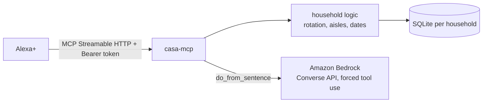

# casa-mcp

**A self-hosted MCP server that lets Alexa+ run a household's shared logistics: the shopping list, bills, chores and the food about to expire.**

"Alexa, add oat milk to the shopping list." "Alexa, whose turn is it to take out the trash?" "Alexa, what do we need to deal with this week?"

Families already talk to Alexa in the kitchen. What they lack is one shared memory for the boring stuff: who paid the gas bill, who did the dishes last, what is going off in the fridge. casa-mcp is that memory, exposed as an [MCP](https://modelcontextprotocol.io) server over Streamable HTTP so Alexa+ (or any MCP client) can read and update it.

## Tools

| Tool | What it does |
|---|---|
| `add_grocery_item` | Adds to the shared list, grouped by supermarket aisle, ignores duplicates |
| `get_grocery_list` | The list in the order you walk the store (read only) |
| `check_off_grocery_item` | Marks an item as bought |
| `add_bill` | Records a bill; due date as `YYYY-MM-DD` or "tomorrow", "in 10 days", "tra 3 giorni" |
| `mark_bill_paid` | Pays the oldest open bill from that provider |
| `upcoming_deadlines` | Unpaid bills in the next N days, overdue ones flagged, with the total (read only) |
| `log_chore` | "Anna took out the trash" |
| `whose_turn` | Fair rotation: whoever did that chore least recently, or never (read only) |
| `add_pantry_item` / `mark_pantry_used` | Tracks food with expiry dates |
| `pantry_expiring` | What to eat before it goes off (read only) |
| `weekly_briefing` | One sentence Alexa can read aloud: bills due, food to use, list size (read only) |
| `do_from_sentence` | "We're out of milk and the gas bill of 80 euro is due Friday" → runs both actions, using **Amazon Bedrock** |

Resource: `casa://briefing` (same content as `weekly_briefing`).

Read-only tools carry the MCP `readOnlyHint` annotation so the assistant can call them without asking for confirmation.

## How it works



- **Transport**: MCP Streamable HTTP at `/mcp`, stateless JSON responses, built on the official Python SDK (`mcp` 2.x).
- **Households**: every bearer token maps to one household (`HOUSEHOLD_TOKENS="token:household,..."`). Every query filters by household; tokens are compared in constant time. A request without a valid token gets `401`.
- **Bedrock**: `do_from_sentence` calls the Bedrock Converse API with a single forced tool (`plan_actions`) whose JSON schema only allows the four write actions, and passes today's date so "Friday" resolves to a real date. The actions are then validated and executed by the same code the individual tools use, so the model can never write anything the tools could not.

## Run locally

```bash
pip install -r requirements.txt
export HOUSEHOLD_TOKENS="$(openssl rand -hex 24):rossi"
python -m casa_mcp.server            # http://localhost:8000/mcp
```

Try it with the MCP Inspector (`npx @modelcontextprotocol/inspector`), transport "Streamable HTTP", URL `http://localhost:8000/mcp`, header `Authorization: Bearer <your token>`.

## Deploy on AWS

`infra/deploy-apprunner.sh` builds the Docker image, pushes it to ECR and creates an App Runner service, then prints the MCP endpoint. You need:

- an ECR access role for App Runner (`APPRUNNER_ECR_ROLE_ARN`),
- for `do_from_sentence`: `BEDROCK_MODEL_ID` (any Bedrock model that supports tool use) and an App Runner instance role allowed to call `bedrock:InvokeModel`,
- `PUBLIC_URL` set to the service URL, so the OAuth protected-resource metadata points at the right place.

Data lives in SQLite inside the container: fine for a demo, it resets on redeploy. Mount a volume or swap `casa_mcp/db.py` for DynamoDB for real use.

## Connect to Alexa+

Register the deployed `https://<host>/mcp` endpoint as a remote MCP server following the Alexa+ MCP instructions provided for the Build, Ship, Shape hackathon, using a household token as the bearer credential.

## Tests

```bash
pip install -r requirements-dev.txt
pytest
```

The suite covers aisle grouping and duplicates, household isolation, spoken dates, bills and overdue detection, fair chore rotation, pantry expiry and the spoken briefing, the Bedrock request shape (with a fake client), and an end-to-end run over HTTP: unauthenticated requests get `401`, and two households see only their own data.

## License

MIT
